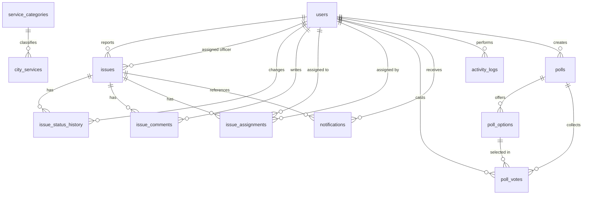

# Database design

CivicFlow uses **MySQL 8+** with InnoDB, `utf8mb4_unicode_ci` and UTC timestamps. The application connects through a `mysql2/promise` pool with parameterised statements.

- Fresh install: `database/schema.sql`
- Existing install: `database/migrations/2026-11-01-platform-upgrade.sql`

The schema seeds **only application taxonomy and settings** — service categories and default platform settings. It does not insert fake citizens, complaints, services or polls.

---

## Entity relationship overview



---

## Tables

### `users`

Accounts for all three roles. Public registration creates `citizen` rows only; officer accounts are provisioned by an administrator and administrators are provisioned from the CLI.

| Column | Type | Notes |
| --- | --- | --- |
| `id` | BIGINT UNSIGNED PK | |
| `full_name` | VARCHAR(120) | |
| `email` | VARCHAR(190) UNIQUE | Stored lowercase by the API |
| `password_hash` | VARCHAR(255) | bcrypt, never exposed |
| `role` | ENUM(`citizen`,`officer`,`admin`) | Default `citizen` |
| `is_active` | TINYINT(1) | Deactivated accounts cannot sign in |
| `phone` | VARCHAR(30) | Optional |
| `department` | VARCHAR(120) | Mainly officers/administrators |
| `last_login_at` | DATETIME | Updated on successful login |
| `created_at`, `updated_at` | TIMESTAMP | UTC |

### `service_categories`

Dynamic taxonomy referenced by `city_services.category`.

| Column | Type | Notes |
| --- | --- | --- |
| `id` | BIGINT UNSIGNED PK | |
| `slug` | VARCHAR(60) UNIQUE | Lowercase identifier used by API and filters |
| `name` | VARCHAR(120) | Public label |
| `description` | VARCHAR(255) | Optional |
| `icon` | VARCHAR(40) | Icon key understood by `icons.js` |
| `sort_order` | INT | Public ordering |
| `is_active` | TINYINT(1) | Inactive categories hide their services publicly |
| `created_at`, `updated_at` | TIMESTAMP | |

Seeded categories: `health`, `transport`, `public_safety`, `shopping`, `government`, `education`, `utilities`, `other`.

### `city_services`

The public service directory.

| Column | Type | Notes |
| --- | --- | --- |
| `id` | BIGINT UNSIGNED PK | |
| `name` | VARCHAR(150) | |
| `category` | VARCHAR(60) FK | References `service_categories.slug` with `ON UPDATE CASCADE ON DELETE RESTRICT` |
| `description` | TEXT | |
| `address` | VARCHAR(255) | Required by the API |
| `area` | VARCHAR(120) | Locality/ward |
| `phone` | VARCHAR(40) | |
| `opening_hours` | VARCHAR(120) | Human-readable schedule |
| `latitude`, `longitude` | DECIMAL(10,7) | Optional pair |
| `is_active` | TINYINT(1) | Deactivated records are preserved but hidden |
| `created_at`, `updated_at` | TIMESTAMP | |

### `issues`

Citizen complaints, including tracking and assignment state.

| Column | Type | Notes |
| --- | --- | --- |
| `id` | BIGINT UNSIGNED PK | |
| `tracking_code` | VARCHAR(32) UNIQUE | `SC-YYYY-XXXXXXXX` |
| `reporter_id` | BIGINT UNSIGNED FK → `users` | `ON DELETE RESTRICT` |
| `title` | VARCHAR(160) | |
| `category` | ENUM | `pothole`, `garbage`, `streetlight`, `water_supply`, `drainage`, `road_damage`, `other` |
| `description` | TEXT | |
| `address` | VARCHAR(255) | Required unless coordinates are supplied |
| `area` | VARCHAR(120) | |
| `latitude`, `longitude` | DECIMAL(10,7) | Optional pair |
| `photo_path` | VARCHAR(500) | Private relative upload path |
| `status` | ENUM | `submitted`, `in_progress`, `resolved`, `rejected` |
| `priority` | ENUM | `low`, `medium`, `high`; default `medium` |
| `assigned_officer_id` | BIGINT UNSIGNED FK → `users` | `ON DELETE SET NULL` |
| `resolution_summary` | TEXT | Required when resolving |
| `resolved_at` | DATETIME | Set when resolved |
| `created_at`, `updated_at` | TIMESTAMP | |

Indexes cover status, category, area, reporter, officer and creation time. Search uses `LIKE` with bound parameters.

### `issue_status_history`

Append-only status transitions. The initial submission is recorded here; legacy complaints receive a backfilled initial row during the migration.

| Column | Notes |
| --- | --- |
| `issue_id` | FK → `issues`, `ON DELETE CASCADE` |
| `changed_by` | FK → `users`, `ON DELETE RESTRICT` |
| `old_status`, `new_status` | Status strings; `old_status` is null for the first row |
| `note` | Up to 500 characters |
| `created_at` | UTC timestamp |

### `issue_comments`

Public updates and internal staff notes.

| Column | Notes |
| --- | --- |
| `issue_id`, `user_id` | Foreign keys |
| `comment` | TEXT |
| `visibility` | ENUM(`public`,`internal`) |
| `created_at` | UTC timestamp |

The timeline endpoint merges history, comments and assignment events. Citizens never receive internal comments; staff do.

### `issue_assignments`

Assignment audit trail.

| Column | Notes |
| --- | --- |
| `issue_id` | FK → `issues`, cascade |
| `officer_id`, `assigned_by` | FK → `users`, restrict |
| `assignment_status` | `assigned`, `reassigned`, `completed` |
| `note` | Up to 500 characters |
| `assigned_at` | UTC timestamp |

### `polls`, `poll_options`, `poll_votes`

| Table | Key rules |
| --- | --- |
| `polls` | Title, description, creator, optional `starts_at`/`ends_at`, `is_active`. Derived status is `scheduled`, `active` or `closed`. |
| `poll_options` | 2–8 options per poll, unique text within a poll (enforced in the controller). Cascade delete with the poll. |
| `poll_votes` | `UNIQUE (poll_id, user_id)` enforces one vote per citizen per poll. Option and poll must match; enforced in the controller. |

Votes cannot be changed after submission in the current product; options cannot be changed after the first vote.

### `notifications`

In-app messages for complaint submission, status changes, assignment, comments, account role/status changes and poll activity.

| Column | Notes |
| --- | --- |
| `user_id` | FK → `users`, cascade |
| `title`, `message` | Display content |
| `notification_type` | Free-form category such as `complaint_status` |
| `related_issue_id` | Optional FK → `issues`, `ON DELETE SET NULL` |
| `is_read` | TINYINT(1) |

### `activity_logs`

Audit trail for accountability.

| Column | Notes |
| --- | --- |
| `user_id` | Nullable FK → `users`, `ON DELETE SET NULL` |
| `action` | Dot-separated action, e.g. `complaint.status_changed` |
| `entity_type`, `entity_id` | Business object reference |
| `details` | JSON text |
| `ip_address` | IPv4/IPv6 text |
| `created_at` | UTC timestamp |

### `platform_settings`

Key/value public settings managed from the admin console:

`platform_name`, `city_name`, `tagline`, `support_email`, `support_phone`, `office_address`.

`updated_by` references `users` with `ON DELETE SET NULL`.

### Legacy `services` table

Some earlier installations include a `services` table. The upgrade migration backfills `city_services` from it when present and leaves the legacy table untouched for rollback. New code reads and writes `city_services` only.

---

## Data integrity rules

1. **Tracking IDs** are generated server-side and retried on collision.
2. **Citizen privacy**: a citizen may read only their own complaint; staff may read all.
3. **Assignments**: only active `officer` accounts can be assigned.
4. **Status transitions** write history and audit rows and notify the reporter for citizen-visible updates.
5. **Resolution**: `resolved` requires a resolution summary and sets `resolved_at`.
6. **Rejection**: requires an explanatory note.
7. **Polls**: one vote per citizen per poll; closed/scheduled polls reject votes; options are locked after voting.
8. **Accounts**: the last active administrator cannot be removed or demoted; officers with open assignments cannot be demoted.
9. **Services**: category slugs must exist; deletion is a soft deactivation; categories with services cannot be deleted.
10. **Timestamps** are UTC; the frontend formats them in the browser's local timezone.

---

## Migration strategy

### Fresh database

```bash
mysql -u root -p -e "CREATE DATABASE smart_city CHARACTER SET utf8mb4 COLLATE utf8mb4_unicode_ci;"
mysql -u root -p smart_city < database/schema.sql
```

### Existing database

Always back up first:

```bash
mysqldump -u root -p --single-transaction --routines smart_city > smart_city_backup.sql
mysql -u root -p smart_city < database/migrations/2026-11-01-platform-upgrade.sql
```

The migration is additive and idempotent:

- Creates missing tables and columns with `CREATE TABLE IF NOT EXISTS` / guarded `ALTER TABLE` procedures.
- Expands legacy enums into the current values.
- Converts `city_services.category` to a slug-backed `VARCHAR` and adds the category foreign key.
- Backfills `city_services` from the legacy `services` table when present.
- Backfills an initial `issue_status_history` row for complaints that have no history.
- Preserves user IDs, complaint IDs, tracking codes and all existing complaint data.
- Inserts only taxonomy/settings defaults; no fake complaints or users.

It can be run again safely. The stored procedures used for guarded alterations are dropped at the end.

### Test database

The smoke suite creates and drops `smart_city_test` automatically. It never writes to `smart_city`. Set `TEST_DB_NAME` to use another disposable name, or `KEEP_TEST_DB=1` to inspect the result.

---

## Useful maintenance queries

```sql
-- Complaint counts by status
SELECT status, COUNT(*) AS total FROM issues GROUP BY status;

-- Unassigned open complaints
SELECT id, tracking_code, title, created_at
FROM issues
WHERE assigned_officer_id IS NULL AND status IN ('submitted', 'in_progress')
ORDER BY created_at ASC;

-- Officer workload
SELECT u.id, u.full_name, COUNT(i.id) AS open_cases
FROM users u
LEFT JOIN issues i
  ON i.assigned_officer_id = u.id AND i.status IN ('submitted', 'in_progress')
WHERE u.role = 'officer' AND u.is_active = 1
GROUP BY u.id, u.full_name
ORDER BY open_cases DESC;

-- Poll participation
SELECT p.id, p.title, COUNT(v.id) AS votes
FROM polls p
LEFT JOIN poll_votes v ON v.poll_id = p.id
GROUP BY p.id, p.title
ORDER BY p.created_at DESC;

-- Recent audit activity
SELECT action, entity_type, entity_id, created_at
FROM activity_logs
ORDER BY created_at DESC
LIMIT 50;
```

### Backups

```bash
# Full logical backup
mysqldump -u root -p --single-transaction smart_city > smart_city_$(date +%F).sql

# Restore
mysql -u root -p smart_city < smart_city_2026-11-01.sql
```

Uploaded photos live under `backend/uploads/` and are not part of a SQL dump. Back that directory up separately. Photos are served only through the authenticated complaint-photo endpoint.
